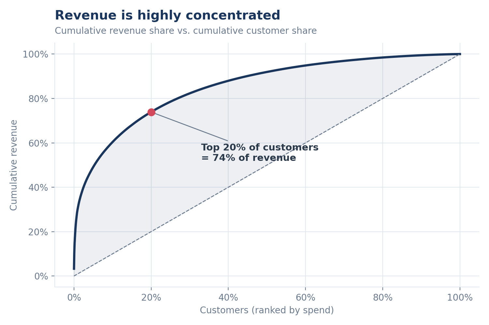
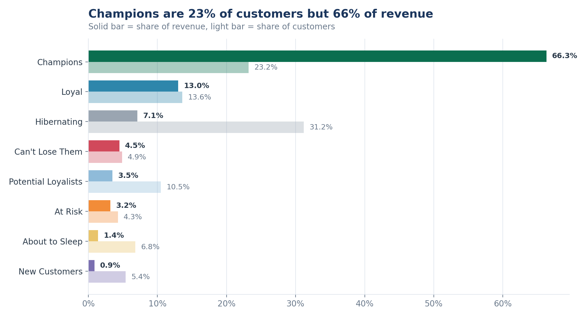
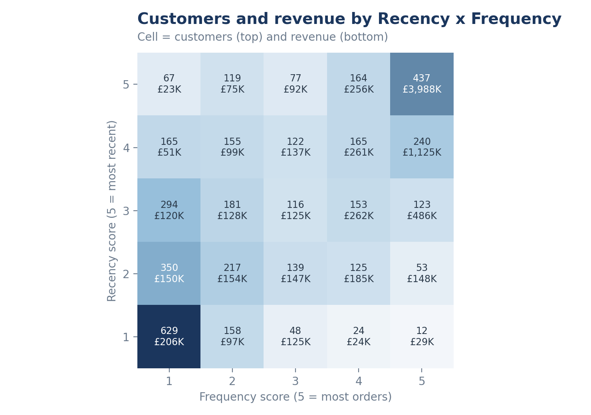
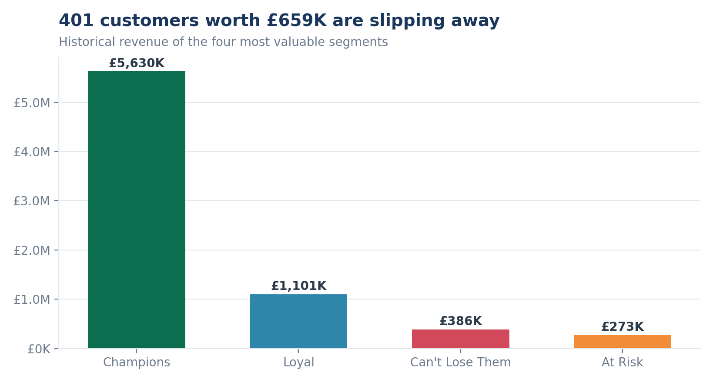
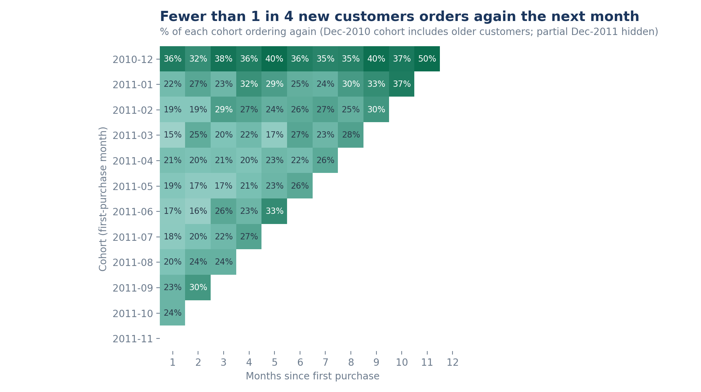
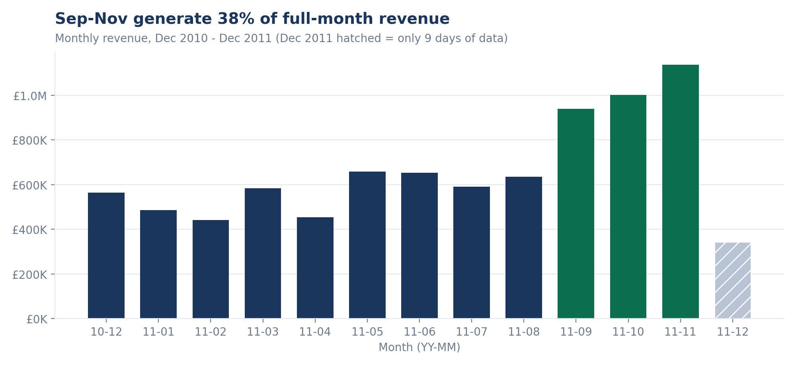

# Which Customers Drive Our Revenue, and Which Are We About to Lose?

> **An RFM customer segmentation and retention case study built with SQL, Python and Tableau on 390K real e-commerce transactions.**


🔗 **[Live interactive dashboard on Tableau Public](https://public.tableau.com/app/profile/zeinab.selim/viz/ExecutiveRFMCustomerIntelligenceDashboard/ExecutiveRFMCustomerIntelligenceDashboard)**

---

## 📌 Executive Summary

A marketing manager has a limited campaign budget and asks three questions: **who should we spend on, who should we rescue before they leave, and what should we say to each group?**

I segmented **4,333 customers** (18,400 orders, **GBP 8.49M** revenue, Dec 2010 – Dec 2011) with an RFM model written entirely in SQL, validated every table against the source totals, and turned the result into a segment-by-segment marketing playbook.

**What the data says**

- **Revenue is extremely concentrated:** the top 20% of customers generate **73.9%** of revenue, and the top 1% alone generate **30.5%**.
- **Champions are the business:** 23.2% of customers (1,006) bring **66.3%** of revenue (GBP 5.63M), with about 11 orders each and a last purchase 13 days before the snapshot.
- **401 high-value customers are slipping away:** the *At Risk* and *Can't Lose Them* segments hold **GBP 659K** of historical revenue (7.8% of the total), and they have not ordered for about 4–5 months.
- **A third of the base is asleep:** 31.2% of customers are *Hibernating* but only 7.1% of revenue, and 72% of them bought just once.
- **Retention is the weak spot:** only about **20%** of new customers (15–24% by monthly cohort) order again the month after their first purchase.
- **Autumn decides the year:** September–November generate **38%** of the revenue of the 12 full months.

---

## 🎯 Business Problem

An online retailer sees total sales but not *who* produces them. Treating all customers the same wastes budget: discounts go to people who would have bought anyway, while valuable customers who quietly stopped ordering are never contacted.

### Business Questions

1. Who are the most valuable customers, and how much of revenue do they represent?
2. Do the top 20% of customers really drive most of the revenue?
3. What natural customer segments exist (by recency, frequency and spend)?
4. How many customers, and how much revenue, are at risk of being lost?
5. Do new customers come back, and how does retention evolve month by month?
6. Which markets, months and products matter most for each segment?
7. What action should marketing take for each segment, and how big is the opportunity?

---

## 📊 Dataset

| Item | Detail |
|---|---|
| **Source** | [UCI Machine Learning Repository – Online Retail](https://archive.ics.uci.edu/dataset/352/online+retail) (license CC BY 4.0) |
| **Original size** | 541,909 transaction lines, 8 columns |
| **Period** | 1 December 2010 – 9 December 2011 |
| **Business** | UK-based online retailer of gifts and homeware; many customers are wholesalers |
| **Analysis data** | 391,148 lines, 4,333 customers, 37 countries, GBP 8,491,574 revenue |

> This is a UK retailer, not Noon or Amazon.ae. The RFM method used here applies directly to any e-commerce business with customer IDs and order dates.

---

## 🔄 Approach (Google Data Analytics framework)

### 1. ASK

- **Stakeholder:** the marketing manager.
- **Decision:** how to split a limited campaign budget across customer groups.
- **Success criterion:** the manager can pick a campaign for every segment, knowing its size and value.

### 2. PREPARE

- Downloaded the UCI file and reviewed columns, date range, missing customer IDs, cancellations (invoices starting with `C`), negative or zero quantities and prices, duplicates and non-product stock codes.
- **Decisions:** exclude rows without a `CustomerID` (RFM needs an identified customer); exclude cancellation lines; snapshot date = **10 Dec 2011** (the day after the last invoice).

### 3. PROCESS (Python + SQL)

The whole pipeline runs from one command (`python python/run_pipeline.py`): Python loads the cleaned file into SQLite, executes the SQL files in order, and exports every table used in Tableau.

**Data quality log** (`data/processed/data_quality_log.csv`)

| Step | Rule | Rows after | Rows removed | Revenue (GBP) |
|---:|---|---:|---:|---:|
| 0 | Raw UCI file | 541,909 | – | – |
| 1 | Basic cleaning: no missing CustomerID, no cancellations, Quantity > 0, UnitPrice > 0, no duplicates | 392,692 | 149,217 | 8,887,209 |
| 2 | Remove non-product codes (POST, M, C2, DOT, BANK CHARGES, PADS) | 391,150 | 1,542 | 8,737,228 |
| 3 | Remove 2 invoices that were fully cancelled in the raw file (541431, 581483) | **391,148** | 2 | **8,491,574** |

**Why step 3 matters:** the raw file contains two giant orders (74,215 and 80,995 units) that were completely reversed by cancellation invoices of the same size. Because cancellations are dropped during cleaning, the original orders would have stayed behind as **GBP 245.7K of fake revenue** and made two customers look like top spenders.

### 4. ANALYZE (SQL)

| File | What it does |
|---|---|
| `01_clean_sales.sql` | Exclusions, `clean_sales` table, data quality log |
| `02_rfm.sql` | Recency, Frequency, Monetary and 1–5 scores |
| `03_segments.sql` | Rule-based segments, segment summary, revenue at risk |
| `04_pareto.sql` | Revenue concentration (window functions) |
| `05_cohorts.sql` | Monthly acquisition cohorts and retention |
| `06_sales_products.sql` | Monthly sales, countries, top products per segment |

**RFM definitions**

- **Recency:** days from the customer's last order to the snapshot date (lower is better).
- **Frequency:** number of distinct invoices.
- **Monetary:** total spend (`Quantity × UnitPrice`).
- **Scores 1–5 (5 = best)** use `PERCENT_RANK`, **not** `NTILE`. `NTILE` splits customers with identical values (for example everyone with one order) across different scores. `PERCENT_RANK` gives ties the same rank, so identical behaviour always receives an identical score.

| Score | Recency (days) | Frequency (orders) | Monetary (GBP) |
|---:|---|---|---|
| 5 | 1 – 13 | 6 – 206 | 2,025 – 279,138 |
| 4 | 15 – 32 | 4 – 5 | 922 – 2,023 |
| 3 | 33 – 71 | 3 | 482 – 922 |
| 2 | 72 – 179 | 2 | 246 – 481 |
| 1 | 180 – 374 | 1 | 3 – 246 |

**Segments** are assigned on the Recency × Frequency grid, so they are mutually exclusive and exhaustive (monetary value is used to profile the segments):

| Segment | Rule | Customers | % customers | Revenue (GBP) | % revenue |
|---|---|---:|---:|---:|---:|
| **Champions** | R ≥ 4 and F ≥ 4 | 1,006 | 23.2% | 5,630,370 | 66.3% |
| **Loyal** | R ≥ 3 and F ≥ 3 | 591 | 13.6% | 1,100,752 | 13.0% |
| **Hibernating** | R ≤ 2 and F ≤ 2 | 1,354 | 31.2% | 606,841 | 7.1% |
| **Can't Lose Them** | R ≤ 2 and F ≥ 4 | 214 | 4.9% | 386,027 | 4.5% |
| **Potential Loyalists** | R ≥ 3 and F = 2 | 455 | 10.5% | 301,125 | 3.5% |
| **At Risk** | R ≤ 2 and F = 3 | 187 | 4.3% | 272,582 | 3.2% |
| **About to Sleep** | R = 3 and F = 1 | 294 | 6.8% | 120,242 | 1.4% |
| **New Customers** | R ≥ 4 and F = 1 | 232 | 5.4% | 73,635 | 0.9% |

**Checks built into the analysis:** segments sum to 4,333 customers; revenue sums to GBP 8,491,574.44 across segments, months, countries and customers; orders sum to 18,400 across months, countries and customers; every customer belongs to exactly one segment.

### 5. SHARE (Tableau Public)

An interactive dashboard that combines KPIs (customers, orders, average order value, revenue), revenue by country, monthly revenue, revenue by segment (treemap and bars) and the top products of each segment.

🔗 [Open the dashboard on Tableau Public](https://public.tableau.com/app/profile/zeinab.selim/viz/ExecutiveRFMCustomerIntelligenceDashboard/ExecutiveRFMCustomerIntelligenceDashboard)

The charts below come from the same SQL outputs (`python/make_charts.py`).








### 6. ACT: a playbook for every segment

| Segment | Goal | Recommended action | KPI to track |
|---|---|---|---|
| **Champions** | Reward and protect | Early access to new products, loyalty tiers, referral programme (no deep discounts: they already buy) | Retention rate, referrals |
| **Loyal** | Raise basket value | Bundles and cross-sell, "complete the set" offers | Average order value, orders per customer |
| **Potential Loyalists** | Build the habit | Reminder and recommendations after each order; incentive for the 3rd order | % reaching a 3rd order |
| **New Customers** | Earn the second order | Welcome series and a second-order offer within 30 days | Second purchase within 30 / 60 days |
| **About to Sleep** | Re-engage early | Light-touch reminders and seasonal content before they lapse | Reactivation rate |
| **At Risk** | Win back | Personal offer plus a reminder of what they bought before | Reactivation rate, recovered revenue |
| **Can't Lose Them** | Rescue | Personal outreach (account manager or phone) and a short survey: these are large, frequent buyers | Recovered revenue |
| **Hibernating** | Stop wasting budget | Cheap automated reactivation only; remove from paid campaigns if they do not respond | Cost per reactivated customer |

**Size of the opportunity (illustrative):** *At Risk* and *Can't Lose Them* together hold **GBP 658.6K** of historical revenue. Recovering just **10%** of it is worth about **GBP 65.9K**. The first test should be an A/B campaign with a 10% hold-out group, so uplift is measured against customers who received nothing.

---

## 💡 Key Insights

1. **The top 20% of customers = 73.9% of revenue** (top 10% = 60.3%, top 50% = 91.9%); 26.8% of customers are enough to reach 80%.
2. **Champions** are 23.2% of customers and 66.3% of revenue, with an average spend of GBP 5,597 each.
3. **Hibernating customers are a third of the base but 7.1% of revenue**, and 72% of them placed a single order.
4. **401 customers worth GBP 659K** (7.8% of revenue) sit in *At Risk* and *Can't Lose Them*.
5. **Only about 20% of new customers return the following month** (15–24% across monthly cohorts).
6. **September–November produce 38%** of the revenue of the 12 full months; November alone is GBP 1.14M.
7. **The UK is 82.4% of revenue**, but a few foreign accounts are very large: the Netherlands (9 customers) and Ireland (3 customers) each contribute about 3%, which points to wholesale buyers.
8. **65.3% of customers ordered more than once**; the Regency Cakestand is the best-selling product in 5 of the 8 segments.

---

## ⚠️ Limitations

- **One year of data.** Seasonality cannot be separated from growth, and recency scores depend on a snapshot taken right after the peak season. December 2011 is a partial month (9 days).
- **Gross revenue, not profit.** There is no cost or margin data, and returns are not netted: cancellations were removed, apart from two fully reversed orders that were excluded explicitly.
- **Only identified customers.** Rows without a `CustomerID` (guest checkouts) were excluded, so the segments describe known customers only.
- **Retail and wholesale are mixed.** A few large accounts drive the concentration; a production analysis would split B2B and B2C.
- **Rule-based segments with percentile cut-offs.** They are easy to explain and act on, but they were not validated against a clustering model.
- **Opportunity sizing is illustrative** and assumes a 10% recovery rate.

**Next steps:** add margin data, validate the segments against K-Means, test the win-back campaign with a hold-out group, and predict churn probability with a purchase-frequency model.

---

## 🔁 Reproduce this project

1. Download **Online Retail.xlsx** from [UCI](https://archive.ics.uci.edu/dataset/352/online+retail) into `data/raw/`.
2. Install the dependencies:
   ```bash
   pip install -r requirements.txt
   ```
3. Run the basic cleaning, the SQL pipeline, then the charts:
   ```bash
   python python/00_basic_cleaning.py
   python python/run_pipeline.py
   python python/make_charts.py
   ```
4. Open `tableau/Online_Retail_RFM_Dashboard_updated.twbx` in Tableau Public.

`run_pipeline.py` builds a local SQLite database, runs the files in `sql/` in order, and writes every table used in Tableau to `data/processed/`.

---

## 📁 Repository Structure

```text
rfm-customer-segmentation/
│
├── data/
│   ├── raw/                          # Online Retail.xlsx (not included)
│   └── processed/
│       ├── customers_rfm.csv         # one row per customer with scores and segment
│       ├── segment_summary.csv
│       ├── revenue_at_risk.csv
│       ├── pareto.csv / pareto_summary.csv
│       ├── cohort_retention.csv
│       ├── monthly_sales.csv / monthly_segment_sales.csv
│       ├── country_sales.csv
│       ├── top_products_by_segment.csv
│       └── data_quality_log.csv
│
├── sql/                              # 01_clean_sales ... 06_sales_products
├── python/                           # 00_basic_cleaning, run_pipeline, make_charts
├── tableau/                          # Tableau workbook
├── images/                           # charts and dashboard screenshot
├── requirements.txt
├── .gitignore
└── README.md
```

---

## 🛠️ Tools

| Tool | Purpose |
|---|---|
| **SQL (SQLite)** | CTEs, window functions (`PERCENT_RANK`, `LAG`, `ROW_NUMBER`, running totals), segmentation, Pareto, cohorts |
| **Python** (pandas, matplotlib) | Cleaning, pipeline orchestration, charts |
| **Tableau Public** | Interactive dashboard |
| **GitHub** | Documentation and portfolio |

---

## 👩‍💻 Author

**Zeinab Khaled**
Data Analyst | Business Information Systems Graduate

- **Portfolio:** [zeinak112.github.io/my_portfolio](https://zeinak112.github.io/my_portfolio/)
- **LinkedIn:** [Zeinab Khaled](https://www.linkedin.com/in/zeinab-khaled-9a5ab8416/)
- **Tableau Public:** [Executive RFM & Customer Intelligence Dashboard](https://public.tableau.com/app/profile/zeinab.selim/viz/ExecutiveRFMCustomerIntelligenceDashboard/ExecutiveRFMCustomerIntelligenceDashboard)
- **Email:** zeinak631@gmail.com

*Data: UCI Online Retail dataset (CC BY 4.0), Chen, D. (2015).*
